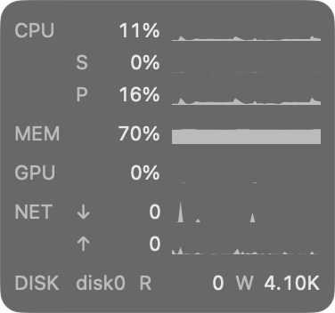
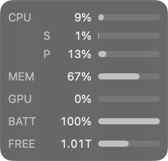
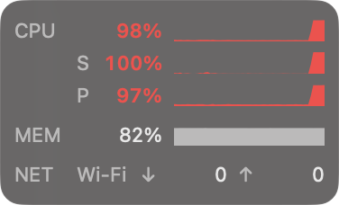
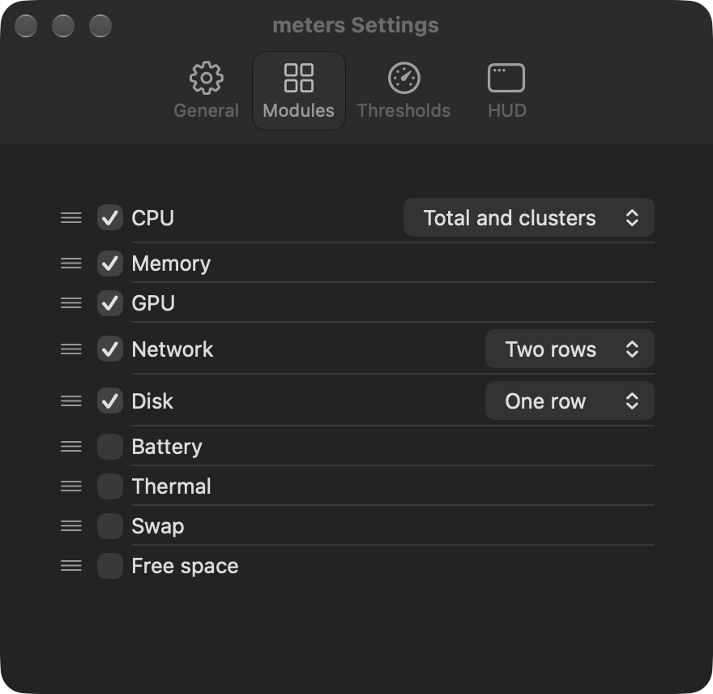

# meters

The Mac system monitor you leave visible.

<p align="center">
  
</p>

meters keeps the few system metrics you care about in a small floating panel that stays on screen while you work. It floats above other windows on every Space, never takes keyboard focus, and stays grey until a reading deserves your attention.

Activity Monitor and terminal tools such as btop are built for investigation; keeping them open costs screen space and attention. Menu bar monitors squeeze into a narrow, crowded strip that the notch partly blocks. meters makes a different trade-off: a panel about 100 to 190 points wide, sized to the modules you choose and placed where you want it.

> **Status (Oct 27, 2026):** v1 is feature-complete and in daily use on an Apple Silicon MacBook Pro. There are no signed or notarized downloads yet, so to run meters today, [build it from source](#build-from-source).

## What it shows

Nine modules, each optional and reorderable:

- **CPU**: total utilization, or split into the core clusters your Mac reports, such as Super and Performance on M5 chips.
- **Memory**: memory used, measured as Activity Monitor measures it. Its highlighting follows macOS memory pressure, not the percentage.
- **GPU**: device utilization.
- **Network** and **Disk**: download and upload, or read and write, rates. One row shows both rates as numbers and names Wi-Fi or the physical disk (such as disk0); two rows add a history graph to each.
- **Battery**: charge, with an arrow for the direction the charge is actually moving, measured from the battery's current.
- **Thermal**: macOS's thermal state as one word: OK, Warm, Hot, or Critical.
- **Swap** and **Free space**: swap in use, and the startup disk's available space as Finder counts it.

The default layout is three rows: CPU, memory, and one-row network. CPU, Memory, GPU, Battery, and Free space can show a bar gauge in place of the 60-reading history graph.

| Gauges | A sustained load past the red threshold |
| --- | --- |
|  |  |

## Thresholds: quiet until interesting

Rows stay grey while readings are normal. A row turns amber or red, with its value in semibold, only after 3 consecutive readings past a threshold, and returns to grey after 3 readings back under, so brief spikes never color it. The defaults, all editable in Settings:

| Module | Amber | Red |
| --- | --- | --- |
| CPU, and each cluster | 70% to 80% | above 80% |
| Memory | macOS memory pressure at warning | memory pressure at critical |
| GPU | 90% or more | none |
| Battery, while draining | 20% or below | 10% or below |
| Thermal | Hot | Critical |
| Swap | over 1 GB | over 8 GB |
| Free space | under 10% of capacity | under 5% of capacity |

Network and Disk have no thresholds.

## Using meters

- **Place it**: drag the panel anywhere on any display. Released within 24 pt of an edge, it snaps into line, and near a corner it settles into the corner; it can also sit beside the Dock. It remembers its position, follows resolution and Dock changes, and moves to the main display when its display disconnects, returning when it reconnects.
- **Show, hide, and quit**: the gauge icon in the menu bar and a right-click on the panel open the same menu: Show or Hide HUD, Settings… (⌘,), and Quit meters (⌘Q). meters has no Dock icon.
- **Configure it**: Settings has four tabs.
  - **General**: launch at login, off by default, and how often to take readings: every 0.5, 1, 2, or 5 seconds.
  - **Modules**: which modules show, their order, and their forms.
  - **Thresholds**: each module's amber and red numbers, or highlighting off.
  - **HUD**: history graphs or gauges. The panel's width and height follow the modules and forms you choose.
- **Accessibility**: every row reads to VoiceOver as one phrase, name first, such as "CPU, 23 percent" or "CPU, 85 percent, critical". The panel follows light and dark appearance and respects Reduce Transparency, Increase Contrast, and Reduce Motion. A threshold state never relies on color alone: the value also turns semibold.

<p align="center">
  
</p>

## Build from source

### Requirements

- An Apple Silicon Mac running macOS 26 or later. Intel Macs are not supported: per-cluster CPU and the GPU figure are Apple Silicon concepts.
- Xcode with a Swift 6.2 or newer toolchain and the macOS 26 SDK or newer. meters is developed and tested with Xcode 27.1 (Swift 6.4) on macOS 27.2. Continuous integration runs the lint, build, test, audit, and smoke checks with Xcode 26.6 on GitHub's macOS 26 runner; its Swift 6.3.3 toolchain built meters without warnings on Oct 26, 2026. Xcode releases older than 26.6 are untested.
- [XcodeGen](https://github.com/yonaskolb/XcodeGen), for example through Homebrew: `brew install xcodegen`.
- `make`, which comes with Xcode's command line tools.

### Build and run

```sh
git clone https://github.com/tonylchang/meters.git
cd meters
make run
```

`make run` generates `meters.xcodeproj` from `project.yml` (the generated project is not tracked), builds the Debug and Release configurations with any compiler warning treated as an error, and opens the Release app from `build/DerivedData/Build/Products/Release/meters.app`. The panel appears at the bottom right of your main display, and the gauge icon appears in the menu bar.

To keep meters, quit it from its menu, copy `meters.app` to `/Applications`, and open it from there. Turn on "Launch at login" on the General tab if you want it at every login.

### Signing

Local builds are signed ad hoc: no Apple Developer account, team, or hardened runtime (see `project.yml`). They are meant for the Mac that built them. Signed and notarized releases are planned but not yet available.

### Make targets

| Command | What it does |
| --- | --- |
| `make build` | Generate the Xcode project and build Debug and Release; any compiler warning fails the build |
| `make run` | Build, then open the Release app with your own settings |
| `make stop` | Quit any running meters |
| `make generate` | Generate `meters.xcodeproj` only, for working in Xcode |
| `make test` | Run the Swift Testing suites, including live cross-checks against system tools such as `top`, `vm_stat`, `netstat`, `df`, and `pmset` |
| `make lint` | Check formatting with `swift format`; `make format` applies it |
| `make audit` | Check the Release app for private frameworks, networking APIs, and entitlements |
| `make smoke` | Launch the Release app in isolated settings and confirm it starts cleanly |
| `make perf` | Measure time to first data, CPU, and memory over five minutes with every module on |
| `make clean` | Remove build output and the generated project |

The checks never touch your saved meters settings. Tests use throwaway settings domains and remove them afterward. `make smoke` and `make perf` open a temporary panel under their own settings and quit it; `make perf` needs an awake, unlocked display for its full five minutes.

## Privacy

meters opens no network connections and has no analytics or crash reporting; `make audit` checks the built app for networking APIs. It needs no administrator password, privileged helper, or extra macOS permission. Settings live in the `net.1x0.meters` preferences domain, and metric history stays in memory, gone when you quit.

## Performance

The targets: under 1% of one CPU core averaged over five minutes, under 50 MB physical footprint, and first data within one second of launch. Measured on the development Mac, an M5 Max with 18 cores on macOS 27.2:

| Run | First data | Self CPU | Footprint |
| --- | --- | --- | --- |
| Oct 17, 2026: every module in its largest form, sized to its modules | 0.376 s | 0.836% | 25.3 MB |
| Oct 12, 2026: every module in its largest form, with history graphs | 0.375 s | 0.913% while other work was running; 0.766% on a 120-second rerun | 25.5 MB |
| Oct 2, 2026: every module, one-row rates with device names | 0.394 s | 0.550% | 25.1 MB |

These are measurements on one Mac, not guarantees for every workload.

## Limits

- GPU utilization, CPU cluster membership, the battery's direction arrow, and memory pressure read undocumented system keys. If a macOS update removes one, the affected row shows `n/a`, the arrow disappears, or highlighting stays normal; meters never shows a made-up value.
- meters has no process list or process control, remote monitoring, fan control, or long-term history.
- Per-sensor temperatures and power draw need private frameworks, so they are planned separately rather than part of v1.

## Roadmap

Planned, in no fixed order:

- Click-to-expand inspection: double-click a row to see its last 300 readings with their minimum, average, and maximum.
- Per-sensor temperatures and power readings.
- Click-through mode, a global hotkey, and threshold notifications.
- Signed releases with a notify-only update check.

## How it's built

Swift 6 with strict concurrency checking, and SwiftUI views hosted in AppKit; the panel is a non-activating `NSPanel`, so clicking it never takes focus from your work.

- `App/`: the app lifecycle, connecting the panel, modules, menu bar, and Settings.
- `Packages/MetersKit/Sources/MetersCore`: system data sources, meter logic, thresholds, layout, and settings. Each metric reads through a protocol, so tests substitute fakes.
- `Packages/MetersKit/Sources/MetersUI`: the panel and its controller, module views, the menu bar item, and the Settings window.
- `Packages/MetersKit/Sources/MetersProbe`: a development-only tool used by `make smoke` and `make perf`.

## Contributing

Issues and pull requests are welcome. [CONTRIBUTING.md](CONTRIBUTING.md) covers what to include in a bug report, which features fit, and the checks a pull request runs.

## License

meters is available under the [MIT License](LICENSE). Changes are listed in [CHANGELOG.md](CHANGELOG.md).
